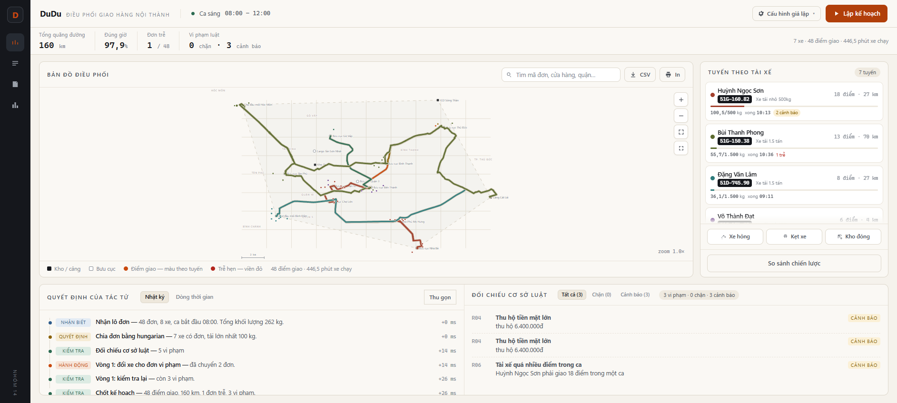
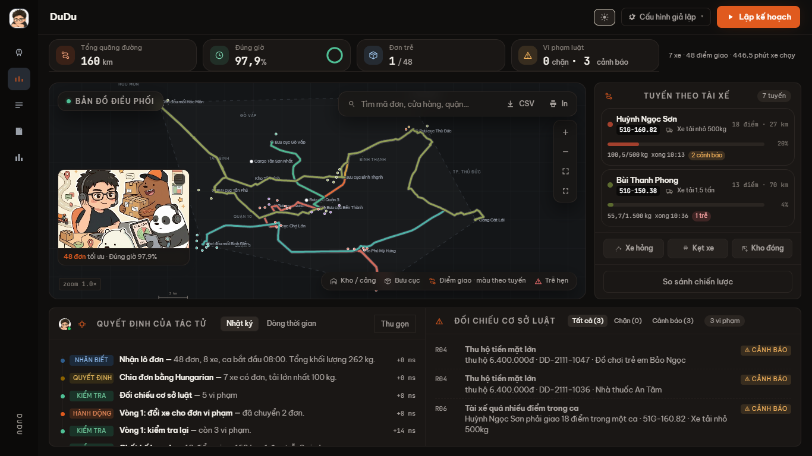

# DuDu — Trung tâm điều phối giao hàng nội thành

[](https://github.com/ThanhTu149/DuDu/actions/workflows/ci.yml)
[](https://github.com/ThanhTu149/DuDu/actions/workflows/e2e.yml)

**Sinh viên thực hiện:** Lê Thanh Tú — Nhóm 14

**Giảng viên hướng dẫn:** Bùi Trọng Hiếu

**Học phần:** Trí tuệ nhân tạo — Trường Đại học Giao thông Vận tải TP.HCM


DuDu là một bảng điều phối (dispatch console) cho bài toán giao hàng chặng cuối ở TP.HCM:
nhận đơn → dự đoán thời gian giao (ETA) → chia đơn cho tài xế → xếp tuyến → kiểm tra
ràng buộc vận hành và giải trình lại quyết định.

Ngoài dữ liệu sinh theo seed, hệ thống nhận **đơn hàng thật từ CSV** (tối đa 200 dòng, kiểm
tra từng dòng), lưu **lịch sử kế hoạch** vào SQLite kèm nút **Lịch sử** trên giao diện để khôi phục lại bản đồ,
KPI và nhật ký. Lịch sử tự chống trùng (cùng cấu hình + kết quả thì cập nhật giờ thay vì thêm
dòng), hiển thị ngữ cảnh (seed / nguồn CSV / loại sự cố / số vi phạm), đánh dấu bản đang xem và
có nút xoá từng bản ghi + **Xoá tất cả**.
Đề tài phát triển từ các gợi ý **31 (tối ưu tuyến đường), 32 (dự đoán ETA), 33 (phân bổ
đơn hàng)** trong danh sách đề tài của học phần.





## Bốn học phần kiến thức được dùng

| Chương | Nội dung | Nằm ở đâu trong dự án |
|---|---|---|
| 1. Tác tử | Tác tử dựa trên mục tiêu/tiện ích, tác tử phản ứng | `backend/dispatch/agent.py` |
| 2. Tìm kiếm | A\* tìm đường vòng khi kẹt xe, VRP, heuristic Nearest Neighbor / 2-opt / Clarke–Wright | `backend/dispatch/network.py`, `routing.py` |
| 3. Logic – suy diễn | Cơ sở luật IF–THEN, giải trình chuỗi suy diễn | `backend/dispatch/rules.py` |
| 4. Máy học | Hồi quy tuyến tính, Random Forest, HistGradientBoosting (HGB) — so sánh thêm trong phần đánh giá nâng cao | `ml/` |

## Cấu trúc thư mục

```
DuDu/
├── data/        dữ liệu điểm giao, ma trận khoảng cách thật (OSRM), dữ liệu huấn luyện
├── backend/     API (FastAPI) + 4 module thuật toán
├── ml/          huấn luyện và đánh giá mô hình ETA
├── web/         giao diện điều phối
└── docs/        kế hoạch, kiến trúc, thiết kế, báo cáo
```

## Chạy web

### Cách 1 — bấm đúp `run.bat` (nhanh nhất)

Mở thư mục repo bằng File Explorer → bấm đúp **`run.bat`**. Script tự tìm Python có đủ
`fastapi`/`uvicorn` (theo thứ tự: biến `DUDU_PYTHON` → `.venv` → `python` trên PATH → các bản
Python cài sẵn trên máy), khởi động server và tự mở trình duyệt ở
`http://127.0.0.1:8000`. Nếu cổng 8000 bận vì DuDu đang chạy sẵn, nó chỉ mở trình duyệt;
nếu bận vì app khác, nó tự nhảy sang 8010/8020… Đóng cửa sổ đen là tắt server.

Không cần làm gì thêm: `data/processed/matrix.json` (ma trận OSRM) và `geometry.json` đã
commit sẵn nên web chạy được ngay, kể cả khi không có mạng.

### Cách 2 — chạy tay bằng lệnh

```powershell
# 1. Cài phụ thuộc (một lần). Python 3.11+
python -m venv .venv
.venv\Scripts\python.exe -m pip install --upgrade pip
.venv\Scripts\python.exe -m pip install -r requirements.txt

# 2. Chạy server, rồi mở http://127.0.0.1:8000
.venv\Scripts\python.exe -m uvicorn backend.app:app --host 127.0.0.1 --port 8000
```

Máy đã có sẵn Python đủ thư viện (không muốn tạo venv) thì bỏ qua bước 1 và thay
`.venv\Scripts\python.exe` bằng `python`.

### Bảo mật (tuỳ chọn)

Mặc định web chạy mở như bản demo. Có thể bật bảo vệ bằng biến môi trường:

```powershell
# bắt buộc header X-API-Key cho mọi /api/* (trừ /api/health)
$env:DUDU_API_KEY = "khoa-bi-mat"
# tối đa 120 request nặng/phút cho mỗi client (mặc định 120)
$env:DUDU_RATE_LIMIT = "120"
```

- Endpoint nặng bị đếm hạn mức: `/api/plan*`, `/api/incident`, `/api/compare`; quá hạn trả
  **429** kèm `Retry-After`.
- Response có `X-Content-Type-Options: nosniff`, `Referrer-Policy: no-referrer` và
  **Content-Security-Policy** (script chỉ từ chính web, font Google được cho phép, inline style
  cho phép vì UI dùng style attribute);
  `/api/health` báo `security.auth_required` và `security.rate_limit_per_minute`.
- Nhận diện client qua header `X-Client-Id` (nếu có) hoặc địa chỉ kết nối; triển khai thật nên
  thay bằng IP sau proxy tin cậy.

### Docker (tuỳ chọn — không cần cài Python)

Docker Desktop phải đang chạy (icon "Engine running"). Lần đầu bấm đúp
**`chay-bang-docker.bat`** — script tự build image, chạy container, chờ `/api/health` rồi mở
trình duyệt. Các lần sau, sau khi Docker Desktop chạy:

```powershell
docker compose up -d        # chạy lại container đã build
# mở http://127.0.0.1:8000
docker compose down         # tắt
docker compose up -d --build  # chỉ khi code/dữ liệu thay đổi
```

Ảnh dựa trên `python:3.11-slim`, có `HEALTHCHECK` gọi `/api/health`, container `restart:
unless-stopped`. Mô hình ETA và dữ liệu thô không nằm trong ảnh — thiếu mô hình thì web vẫn
chạy bằng OSRM free-flow. Đã build và chạy thử thật: `/api/health` trả `ok`, lập kế hoạch 12
đơn và trang chủ HTTP 200; kích thước ảnh ~773 MB (phần lớn scipy/pandas/scikit-learn).

**Ngày thường chỉ cần `run.bat`** (nhẹ, nhanh, không cần Docker Desktop). Docker dùng khi đưa
sang máy khác / chấm bài không muốn cài Python.

### Mô hình ETA (tuỳ chọn)

Tệp `ml/models/eta_rf.joblib` (~105 MB) **không commit** vì nặng. Nếu thiếu, web vẫn chạy
bình thường: nút "ETA mô hình" dùng OSRM free-flow và API trả `warnings`. Muốn bật mô hình
thật:

```powershell
# tải parquet NYC TLC (~48 MB) vào data/raw/ rồi:
python ml/build_dataset.py --force
python ml/train_eta.py
```

### Chạy lại dữ liệu/kết quả (tuỳ chọn)

```powershell
python data/build_matrix.py            # gọi OSRM sinh lại ma trận (cần mạng)
python -m backend.dispatch.evaluate --report   # sinh bảng kết quả VRP
python -m unittest discover -s tests -v        # 142 ca kiểm thử
```

## Dữ liệu

- **Mạng đường TP.HCM**: OpenStreetMap qua OSRM công khai (`router.project-osrm.org`).
  Khoảng cách và thời gian di chuyển là số thật, không phải tự bịa.
- **Điểm giao**: 16 nút thật (cảng Cát Lái, ICD Sóng Thần, chợ đầu mối Bình Điền,
  các bưu cục quận…) + đơn hàng sinh theo seed để tái lập được kết quả.
- **ETA**: xem `ml/README.md` — dữ liệu hành trình thật, có hiệu chỉnh về bối cảnh TP.HCM.

## Kết quả thực nghiệm (sinh tự động, tái lập được)

Ba script dưới đây sinh báo cáo trong `docs/`, seed cố định nên chạy lại ra đúng từng con số:

```powershell
python -m backend.dispatch.optimal --report     # -> docs/ket-qua-toi-uu.md
python -m backend.dispatch.robustness --report  # -> docs/ket-qua-do-ben.md
python ml/advanced_eval.py --report             # -> docs/ket-qua-eta-nang-cao.md
```

- **Optimality gap xếp tuyến** (`docs/ket-qua-toi-uu.md`): so 6 chiến lược sắp thứ tự giao
  với thứ tự tối ưu (Held–Karp) trên cùng phân công. NN + 2-opt chỉ lệch **1,4%** (lớn nhất
  2,9%), Nearest Neighbor lệch 2,8%, thứ tự nhập đơn lệch 17,6%.
- **Độ bền vững** (`docs/ket-qua-do-ben.md`): 30 seed × (48 đơn, 8 xe) cho quãng đường
  179,5 ± 36,3 km, đúng giờ 99,4 ± 1,3%; 2-opt giảm 29,3% quãng đường so với thứ tự nhập đơn;
  chiến lược `deadline` thêm 9,7% km nhưng kéo đơn trễ từ 2,23 xuống 0,27.
- **Độ nhạy tham số**: `max_rounds` hội tụ sau 4 vòng; bán kính vùng ùn tắc 2→8 km làm A*
  phải đi vòng 3,5→227,4 km, là căn cứ chọn mặc định 4,5 km.
- **ETA nâng cao** (`docs/ket-qua-eta-nang-cao.md`): tuning 7 cấu hình HGB bằng rolling-origin
  CV (3 fold); khoảng tin cậy 80% học từ phân vị phần dư đạt độ phủ **81,3%**, rộng trung bình
  11,3 phút so với baseline ±15% chỉ phủ 40,0%; bỏ nhóm đặc trưng giờ làm MAE tăng
  3,489 → 3,806 phút.
- **Cơ sở luật** (`docs/co-luat.md`): nguồn nghiệp vụ, ma trận xung đột ưu tiên và bảng đối
  chiếu 21 ca kiểm thử cho R01–R12; `docs/ARCHITECTURE.md` có 4 sơ đồ Mermaid (kiến trúc, vòng
  đời tác tử, luồng dữ liệu, xử lý sự cố bằng A*).
- **Hiệu năng API** (`docs/ket-qua-hieu-nang.md`): 48 đơn ~22 ms, 96 đơn ~55 ms, 144 đơn
  ~95 ms, 200 đơn ~1,2 s (2-opt tính chi phí bằng mảng cục bộ, nhanh hơn ~4× so với trước);
  8 luồng × 5 request không lỗi, kết quả nhất quán nhờ cache + lock. Chạy lại bằng
  `python tools/bench_api.py --report`.

## Kiểm thử giao diện (E2E)

Smoke test Playwright đi qua 3 luồng chính (lập kế hoạch 48 đơn → mở **Lịch sử** và khôi phục
kế hoạch → nhập CSV mẫu 12 đơn) và kiểm tra thêm **Content-Security-Policy** + a11y cơ bản
(ảnh có alt, nút có tên, id không trùng, html lang=vi). Mọi lỗi JS hoặc response ≥ 400 đều làm
test fail; ảnh chụp khi lỗi lưu trong `tests/e2e/artifacts/`.

```powershell
# một lần: cài Playwright + Chromium
npm install
npx playwright install chromium

# server phải đang chạy (run.bat), rồi:
node tests/e2e/smoke.cjs
```

Máy dev đã có Chromium riêng thì đặt thêm `$env:E2E_CHROMIUM = "đường dẫn chrome.exe"`.
GitHub Actions chạy tự động qua workflow `.github/workflows/e2e.yml` (server nền + Playwright).

## Kiểm thử tự động

Repo có bộ kiểm thử cho phần lõi (không cần cài mô hình, không gọi mạng):

```powershell
pip install -r requirements-lock.txt -r requirements-dev-lock.txt   # bản khoá đã kiểm thử
python -m unittest discover -s tests -v
```

**142 ca kiểm thử** trong `tests/` phủ các nhóm: mạng lưới và A* (gồm cả việc A* bắt buộc phải
đi vòng khi chặng bị chặn), bài toán gán Hungarian (đối chiếu với vét cạn), xếp tuyến (2-opt
không bao giờ làm xấu kết quả, tổng km khớp), 12 luật vận hành, tác tử + API + toàn vẹn dữ
liệu, nhập CSV + lịch sử kế hoạch, frontend/launcher và khoảng tin cậy ETA.
GitHub Actions chạy lại toàn bộ ở mỗi lần push: `.github/workflows/ci.yml`.

## Hạn chế đã biết

Nói rõ để người đọc không hiểu nhầm số liệu là thực tế TP.HCM:

1. **Dữ liệu ETA là taxi New York, không phải TP.HCM.** Mô hình học quan hệ quãng đường –
   giờ – thứ → thời lượng, rồi hiệu chỉnh hệ số ùn tắc theo khung giờ khi dự đoán. Chưa có
   dữ liệu GPS xe giao hàng thật ở TP.HCM để kiểm chứng.
2. **Đồ thị chỉ có 16 nút** (bưu cục, cảng, chợ đầu mối). Khoảng cách giữa các nút là số thật
   từ OSRM, nhưng tuyến trong phố nhỏ không được mô hình hoá; đây là mức trừu tượng phù hợp
   cho bài toán chia đơn, không phải chỉ đường từng ngõ.
3. **Đơn hàng mô phỏng theo seed** (chế độ mặc định; hệ thống đã hỗ trợ nhập lô đơn thật từ
   CSV), không phải lô đơn thật. Ưu điểm của chế độ seed là tái lập được kết quả.
4. **A\* trên đồ thị đầy đủ**: nếu không có chặn, đường tối ưu luôn là đi thẳng, nên A\* chỉ
   thật sự có tác dụng khi mô phỏng kẹt xe (một số chặng xuyên tâm bị chặn, xe phải vòng).
5. **Chưa có dữ liệu giao thông thời gian thực**, hệ số ùn tắc là giả định theo khung giờ.
6. **ETA hiển thị trên bản đồ chỉ là ước lượng**, kế hoạch giả định thời gian phục vụ cố định
   tại mỗi điểm.

## Giấy phép

Mã nguồn: **MIT** — xem `LICENSE`.
Dữ liệu bản đồ: OpenStreetMap / OSRM, theo **ODbL 1.0**, cần ghi công "© OpenStreetMap contributors".
Chi tiết nguồn dữ liệu, cách tái tạo: `docs/DATA.md`.

## Ghi chú

Môi trường tái lập: `requirements-lock.txt` (+ `requirements-dev-lock.txt`) khoá đúng phiên bản
đã kiểm thử; Docker và CI dùng các file này. `requirements.txt` giữ dải `>=` cho ai muốn bản mới.

Repo dùng commit theo từng bước công việc nhỏ, chia theo mảng để lịch sử đọc được như nhật
ký làm việc. Xem `docs/PLAN.md` để biết tiến độ.

## Tài liệu

| Tệp | Nội dung |
|---|---|
| `docs/PLAN.md` | Kế hoạch, phạm vi, phân công, rủi ro |
| `docs/TASKS.md` | Bảng việc kỹ thuật và tiến độ |
| `docs/ARCHITECTURE.md` | Kiến trúc, ranh giới module, danh sách API |
| `docs/DESIGN.md` | Hệ thống thiết kế giao diện (màu, chữ, bố cục, component) |
| `docs/ket-qua-vrp.md` | Kết quả thí nghiệm xếp tuyến theo quy mô |
| `docs/ket-qua-eta.md` | Kết quả mô hình dự đoán thời gian giao |
| `docs/ket-qua-luat.md` | Thống kê kích hoạt 12 luật trên ba kịch bản |
| `docs/co-luat.md` | Nguồn gốc 12 luật, ma trận xung đột ưu tiên, độ phủ kiểm thử |
| `docs/ket-qua-toi-uu.md` | Optimality gap phần xếp tuyến (Held–Karp) |
| `docs/ket-qua-do-ben.md` | 30 seed, so sánh chiến lược, độ nhạy tham số |
| `docs/ket-qua-eta-nang-cao.md` | Tuning CV, khoảng tin cậy 80%, ablation đặc trưng ETA |
| `docs/ket-qua-hieu-nang.md` | Độ trễ API theo số đơn, gọi đồng thời, giới hạn hiệu năng |
| `docs/import-csv.md` | Định dạng CSV nhập đơn, API lịch sử kế hoạch, file mẫu |
| `docs/DATA.md` | Nguồn dữ liệu, giấy phép, cách tái tạo |
| `docs/REVIEW.md` | Tự đánh giá điểm yếu và những gì đã khắc phục |
| `docs/design-system/tailwind-snippets.md` | Snippet Tailwind (tương đương Dev Mode của Figma) |
| `docs/WORKFLOW.md` | Quy ước: mọi thay đổi đều phải push; script `tools/push.ps1` tự kiểm thử rồi push |

Các tệp kết quả đều sinh tự động bằng lệnh trong mã nguồn, chạy lại thực nghiệm là số liệu
tự khớp.


