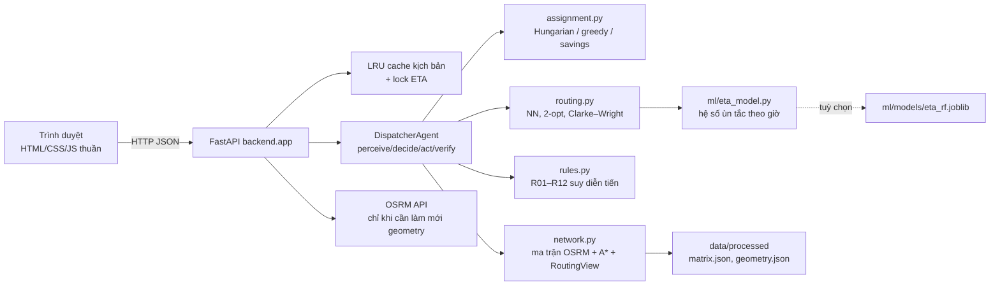
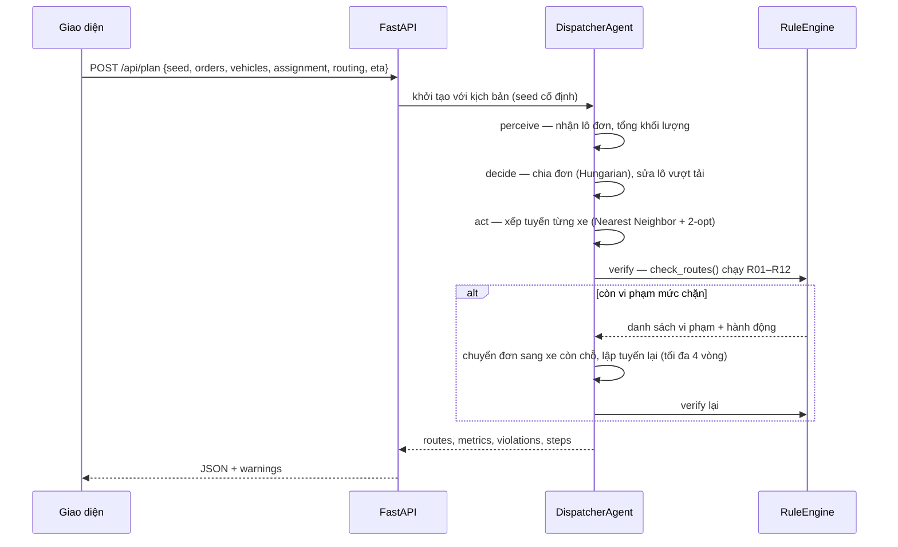
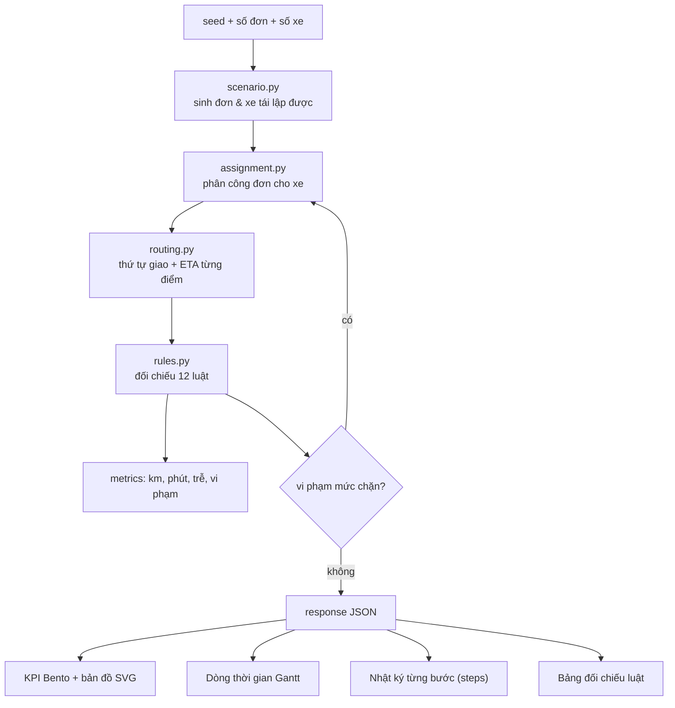
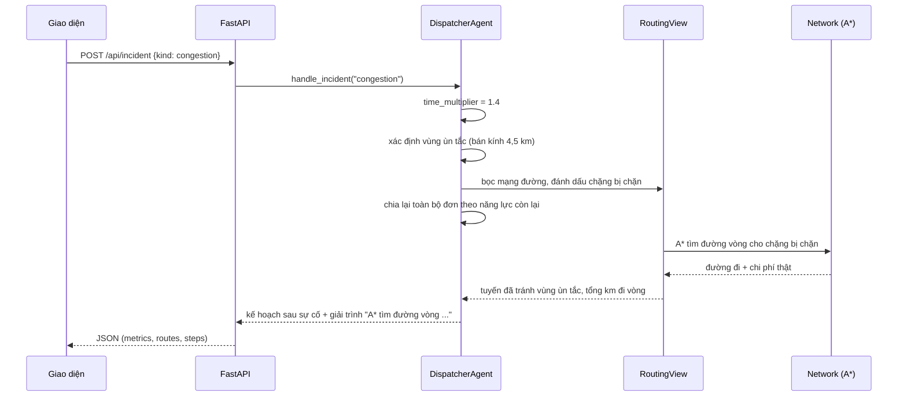

# Kiến trúc DuDu

## Luồng một lần lập kế hoạch

```
Kịch bản (16 nút + 48 đơn)                      data/hubs.json, scenario.py
        │
        ▼
[1] Mạng lưới  ── ma trận thời gian/khoảng cách thật từ OSRM ── network.py
        │
        ▼
[2] Chia đơn cho tài xế   ── chia lô theo tải ── ghép lô–xe bằng Hungary  assignment.py
        │
        ▼
[3] Xếp tuyến từng xe     ── Nearest Neighbor → 2-opt ── ETA từng điểm    routing.py
        │
        ▼
[4] Đối chiếu cơ sở luật  ── 8 luật IF–THEN, suy diễn tiến, có giải trình  rules.py
        │
        ▼
[5] Tác tử sửa và lặp     ── vi phạm → đổi xe → lập lại tuyến → kiểm tra   agent.py
        │
        ▼
   Kế hoạch + số liệu + nhật ký quyết định  ──►  API  ──►  giao diện
```

## Ranh giới module

| Module | Trách nhiệm | Không làm gì |
|---|---|---|
| `network.py` | nạp ma trận, A*, khoảng cách chim bay | không quyết định gì |
| `assignment.py` | chia đơn thành lô, ghép lô với xe | không xếp thứ tự trong tuyến |
| `routing.py` | thứ tự giao, ETA, tổng km | không đổi xe của đơn |
| `rules.py` | cơ sở luật, giải trình | không tự sửa kế hoạch |
| `agent.py` | vòng lặp nhận biết–quyết định–hành động | không tự tính tuyến, chỉ gọi lại |
| `app.py` | API mỏng | không chứa thuật toán |
| `web/` | hiển thị và thao tác | không tự tính toán gì |

Quy ước: mọi module thuật toán nhận `Network` + danh sách dict thuần, trả về dict hoặc
dataclass có `as_dict()`. Nhờ vậy API và giao diện không phụ thuộc vào chi tiết cài đặt.

## API

| Endpoint | Việc |
|---|---|
| `GET /api/health` | sống/chết, số nút, số luật, mô hình ETA có sẵn, uptime, biên dữ liệu |
| `GET /api/hubs` | 16 nút + khung bao để vẽ bản đồ |
| `GET /api/scenario?seed&orders&vehicles` | kịch bản tái lập được (cache theo bộ ba tham số) |
| `POST /api/plan` | chạy tác tử: tuyến, số liệu, vi phạm, nhật ký; trả thêm `warnings` |
| `POST /api/incident` | sự cố xe hỏng / kẹt xe (A* đi vòng) / kho đóng / cấm tải → chia lại |
| `GET /api/compare?seed&orders` | bảng so sánh chiến lược chia đơn và xếp tuyến |
| `GET /api/rules` | 12 luật kèm mức và độ ưu tiên |
| `GET /api/eta/info` | thông tin mô hình ETA (MAE, số dòng, hệ số ùn tắc) |
| `GET /api/eta/predict?distance_km&hour&weekday` | dự đoán ETA cho một chặng |
| `GET /api/geometry?a&b` | đường đi thật giữa 2 nút (cache đĩa, khoá ghi) |
| `POST /api/plan/import` | lập kế hoạch từ CSV do người dùng nhập (`import.count`, `import.warnings`, `history_id`) |
| `GET /api/orders/template` | tải CSV mẫu |
| `GET /api/history` | 20 kế hoạch gần nhất (metadata + metrics tóm tắt) |
| `GET /api/history/{id}` | khôi phục toàn bộ payload một kế hoạch |

## Bảo mật

`backend/security.py` gắn `SecurityMiddleware` vào app:

- **API key tuỳ chọn**: biến `DUDU_API_KEY` — nếu đặt, mọi `/api/*` trừ `/api/health` phải có
  header `X-API-Key`; thiếu/sai trả 401.
- **Giới hạn tần suất**: `DUDU_RATE_LIMIT` request nặng/phút mỗi client (`X-Client-Id` hoặc IP),
  áp cho `/api/plan*`, `/api/incident`, `/api/compare`; quá hạn trả 429 + `Retry-After`.
- Thêm header `X-Content-Type-Options: nosniff`, `Referrer-Policy: no-referrer`.
- `/api/health` công khai và trả `security.auth_required`, `security.rate_limit_per_minute`.

## Kiểm tra dữ liệu vào

Mọi endpoint POST dùng **Pydantic** để chặn dữ liệu sai trước khi chạy thuật toán:

| Quy tắc | Giá trị | Trả về khi sai |
|---|---|---|
| `orders` | 8–200 | 422 |
| `vehicles` | 2–8 | 422 |
| `seed` | 1–9999 | 422 |
| `assignment` | hungarian / greedy / savings / random | 422 |
| `routing` | deadline / nearest / two_opt / random / savings / savings_2opt | 422 |
| `eta` | osrm / ml | 422 |
| `kind` sự cố | breakdown / congestion / depot_closed / truck_ban | 422 |
| `vehicle_id`, `hub_id` | phải tồn tại trong kịch bản/mạng | 400 kèm danh sách hợp lệ |

Lỗi không lường trước được bọc trong một handler chung: trả `{"detail": "Lỗi nội bộ máy chủ",
"type": ...}` và ghi log, không đẩy stack trace ra ngoài.

## Hiệu năng & cache

- Kịch bản theo `(seed, orders, vehicles)` cache **64** mục; kế hoạch "trước sự cố" theo
  `(seed, orders, vehicles, assignment, routing)` cache **64** mục → bấm sự cố liên tiếp
  không phải tính lại kế hoạch gốc.
- Mô hình ETA nạp ở **luồng nền lúc khởi động** (lifespan) và lưu không nén: nạp ~0,2 giây
  thay vì 2–3 giây; `/api/health` chỉ kiểm tra tệp có tồn tại, không nạp mô hình.
- Đo trên máy phát triển (48 đơn, 8 xe): `/api/plan` 20–40 ms (riêng 96 đơn ~180 ms),
  `/api/incident` 20–65 ms, `/api/compare` ~260 ms, `/api/eta/predict` ~90 ms.

## Ghi chú kỹ thuật

- **A\* dùng ở đâu trong hệ thống thật?** Khi mô phỏng "kẹt xe diện rộng", các nút nằm trong
  bán kính 4,5 km quanh tâm thành phố bị chặn **đi thẳng** với nhau (`congestion_edges`).
  Tác tử bọc mạng lưới bằng `RoutingView`: chặng nào bị chặn thì gọi A* tìm đường vòng qua
  nút khác, rồi cộng km/phút của đường vòng vào kế hoạch. Nhật ký ghi rõ "A* tìm đường vòng
  tránh vùng ùn tắc: N chặng, +X km" để giảng viên thấy thuật toán thật sự chạy, không phải
  khai báo cho có. Heuristic dùng đường chim bay chia tốc độ tối đa 70 km/h nên không vượt
  chi phí thật (điều kiện admissible); kiểm thử `tests/test_network.py` khẳng định đường
  vòng không đi qua chặng bị cấm và luôn đắt hơn đường trực tiếp.
- **Vì sao 2-opt có hai hàm mục tiêu?** Một tuyến ngắn nhất chưa chắc giao đúng hẹn. Báo cáo
  so sánh hai biến thể để thấy rõ đánh đổi km ↔ tỷ lệ đúng giờ.
- **Vì sao có bước sửa tải sau Hungary?** Hungary tối thiểu chi phí, không biết ràng buộc
  sức chứa theo từng xe; bước sửa chuyển đơn nhỏ nhất sang xe còn chỗ.
- **Vì sao đơn được làm tròn về nút mạng?** 16 nút đại diện cho 16 khu vực; toạ độ thật của
  đơn lệch trong bán kính ~1 km để bản đồ không chồng điểm, còn định tuyến dùng nút.


## Sơ đồ

Bốn sơ đồ dưới đây dùng cú pháp Mermaid (GitHub render trực tiếp).

### 1. Kiến trúc tổng thể



### 2. Vòng đời tác tử một kế hoạch



### 3. Luồng dữ liệu của một lần lập kế hoạch



### 4. Xử lý sự cố (kẹt xe) với A* tìm đường vòng




